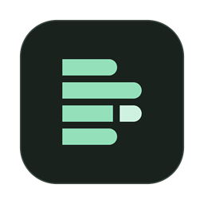
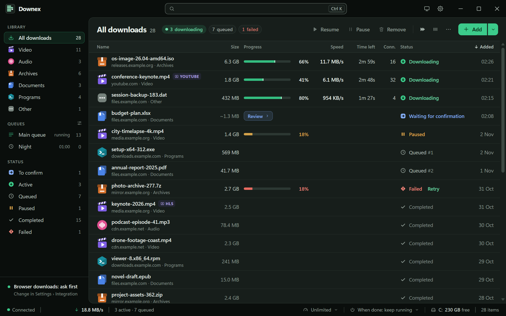
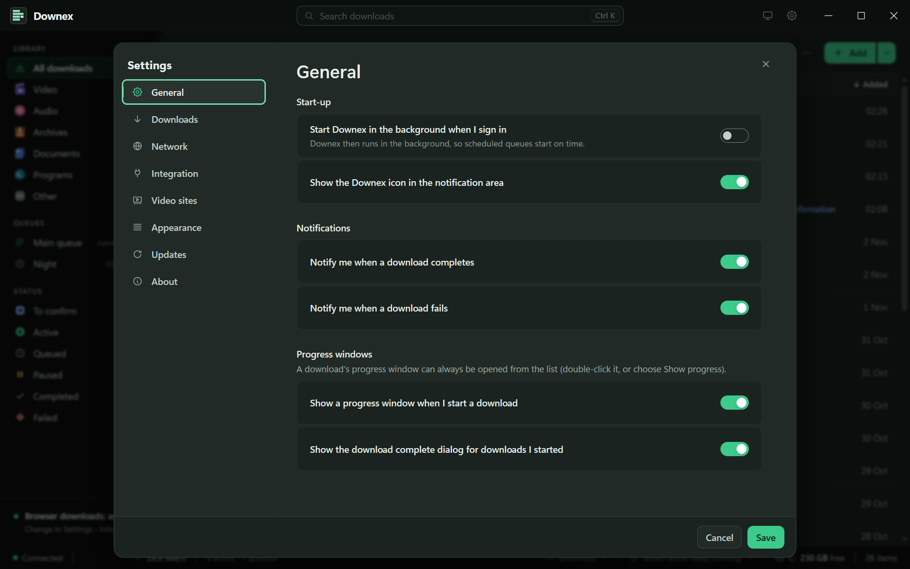
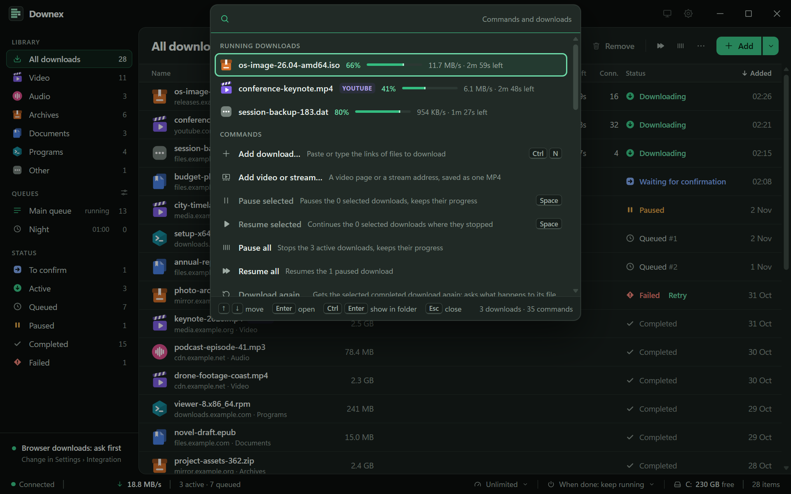

<p align="center">
  
</p>

<h1 align="center">Downex</h1>

<p align="center">
  <strong>The fast, private download manager for Windows and macOS.</strong><br>
  Many connections per file, resume after anything, videos as one MP4 — all on your own computer.
</p>

<p align="center">
  <a href="LICENSE"></a>
  
  
  
  
  <a href="https://github.com/rawaz4/downex/releases"></a>
</p>

<p align="center">
  <a href="https://downex.app"><b>Website</b></a> ·
  <a href="#install"><b>Install</b></a> ·
  <a href="#features"><b>Features</b></a> ·
  <a href="#privacy"><b>Privacy</b></a> ·
  <a href="#build-from-source"><b>Build</b></a> ·
  <a href="docs/USAGE.md"><b>Docs</b></a> ·
  <a href="https://github.com/rawaz4/downex"><b>Source</b></a>
</p>

<p align="center">
  <picture>
    <source media="(prefers-color-scheme: light)" srcset="docs/images/main-light.png">
    
  </picture>
</p>

> [!NOTE]
> **Downex 1.1.2 is out:** the progress window now opens right after you start a download, a
> smooth progress bar, the browser extension from the Chrome Web Store and Firefox Add-ons, and
> updates that replace exactly your installation (see the [changelog](CHANGELOG.md)). Download it from the
> [release page](https://github.com/rawaz4/downex/releases/tag/v1.1.2) or
> [downex.app](https://downex.app), or [build it from source](#build-from-source). The source
> code is at [github.com/rawaz4/downex](https://github.com/rawaz4/downex).

## Why Downex

- **Fast.** Each file is split over up to 32 connections, opened as fast as the server keeps up.
- **Never starts over.** Pause, quit, crash or reboot: Downex continues where it stopped.
- **Videos, done right.** Save the video of a web page — or a whole stream — as one `.mp4` file.
- **Native and light.** A real Windows and macOS app, not a web page in a window: a fraction of
  the memory of browser-based apps, and the background service rests when there is nothing to do.
- **Private by design.** No account, no cloud, no ads, no telemetry. Free and open source.

## Features

<table>
  <tr>
    <td width="50%" valign="top">
      <h3>⚡ Segmented downloads</h3>
      Up to 32 connections per file, HTTP/2, per-site connection limits, and speed limits for
      everything, per queue or per download.
    </td>
    <td width="50%" valign="top">
      <h3>🔁 Resume anything</h3>
      Progress is saved only once it is safely on disk, so nothing is lost. A file that changed on
      the server is detected and never mixed with the old one.
    </td>
  </tr>
  <tr>
    <td valign="top">
      <h3>🌐 Browser integration</h3>
      An extension for Chrome, Edge, Brave and Firefox hands downloads to Downex with the page's
      sign-in, and can ask you first for the name, folder and category.
    </td>
    <td valign="top">
      <h3>🎬 Videos and streams</h3>
      A <i>Download</i> button over web videos, HLS and DASH streams, and YouTube and the many sites
      <a href="https://github.com/yt-dlp/yt-dlp">yt-dlp</a> supports — in the quality you pick,
      always one <code>.mp4</code>, never re-encoded.
    </td>
  </tr>
  <tr>
    <td valign="top">
      <h3>🗓️ Queues and schedules</h3>
      Several queues with their own limits, start and stop times, and an action when they finish:
      sleep, hibernate, shut down or quit.
    </td>
    <td valign="top">
      <h3>🖥️ Made for your desktop</h3>
      A progress window per download, tray and menu-bar icon, notifications, categories with their
      own folders, a clipboard monitor, proxies, a virus-scan hook and dark mode.
    </td>
  </tr>
  <tr>
    <td valign="top">
      <h3>🔐 Safe by default</h3>
      Downloaded files carry Windows' Mark of the Web and macOS's quarantine flag; passwords stay in
      the system's credential store; updates are signed and checked before they install.
    </td>
    <td valign="top">
      <h3>⌨️ Command line too</h3>
      <code>downex</code> does everything the window does, for scripts and terminals.
    </td>
  </tr>
</table>

<p align="center">
  
  
</p>
<p align="center"><sub>Settings in the style of your system · the command palette (<kbd>Ctrl</kbd> <kbd>K</kbd>, <kbd>⌘</kbd> <kbd>K</kbd> on a Mac)</sub></p>

## Install

| | Windows | macOS |
|---|---|---|
| **Needs** | Windows 10 or 11 (x64) | macOS 13 Ventura or later (Intel and Apple silicon) |
| **Download** | `Downex-Setup-1.1.2.exe` from the [release page](https://github.com/rawaz4/downex/releases/tag/v1.1.2) or [downex.app](https://downex.app) | `Downex-1.1.2.dmg` from the same [release page](https://github.com/rawaz4/downex/releases/tag/v1.1.2) or [downex.app](https://downex.app) |
| **Installs** | for you only, no administrator rights | drag **Downex** onto **Applications** |

To check your download, compare its SHA-256 checksum with the one in `SHA256SUMS.txt` on the
[release page](https://github.com/rawaz4/downex/releases/tag/v1.1.2). On Windows:
`Get-FileHash Downex-Setup-1.1.2.exe` in PowerShell; on a Mac: `shasum -a 256 Downex-1.1.2.dmg`.
Upper and lower case letters count as the same.

<details>
<summary><b>Windows details</b></summary>

Setup installs Downex into `%LOCALAPPDATA%\Programs\Downex`: the window, the background service
`downexd`, the command-line client `downex`, the browser relay and the extension's files. It
registers the relay with your browsers and can start Downex when you sign in (off by default).
When a new version is out, Downex asks you in its window: **Update now** installs it quietly and
reopens the window, **Later** asks again another time. Uninstall from *Settings → Apps*; your
downloaded files are never touched.

**First run.** Setup is not code-signed, so Windows may warn you before it runs. When SmartScreen
says *Windows protected your PC*, choose **More info** → **Run anyway**. On a PC with Smart App
Control turned on, Windows may refuse unsigned apps altogether.

Then add the browser extension: see [The browser extension](#the-browser-extension). Silent
installs and everything Setup changes: [docs/USAGE.md](docs/USAGE.md#install-windows).
</details>

<details>
<summary><b>macOS details</b></summary>

1. Open `Downex-<version>.dmg` and drag **Downex** onto **Applications**.
2. Open Downex from **Applications**. Downex is not notarised by Apple: on macOS 13 and 14
   Control-click Downex and choose **Open**; on macOS 15 and later open it once, then choose
   **Open Anyway** in *System Settings → Privacy & Security*.
3. Each time it opens, Downex connects itself to the browsers you have opened at least once. To
   do it again by hand, use *Settings → Integration → Register with browsers again*, or in
   Terminal: `/Applications/Downex.app/Contents/Helpers/downex-nmhost register`.
4. Add the browser extension: see [The browser extension](#the-browser-extension).

More: [docs/USAGE.md](docs/USAGE.md#installing-on-a-mac).
</details>

### The browser extension

The extension hands your browser's downloads and videos to Downex. It works in **Google Chrome,
Microsoft Edge, Brave** and **Chromium** (based on Chromium 116 or later) and in **Firefox** (140
or later). The Chrome Web Store copy also installs in Opera, Vivaldi and other Chromium browsers,
but Downex connects itself only to the browsers named here, so there the extension may say that
Downex isn't set up.

**Before you start.** Install Downex and open it once.

- **Windows:** Setup already connected Downex to Chrome, Edge, Brave, Chromium and Firefox.
- **macOS:** each time it opens, Downex connects itself to the browsers you have opened at least
  once. If you install a browser later, open that browser once, then open Downex again.

**Add it from the store.** One click, and the store keeps it up to date. Downex's
*Settings → Integration* has the same buttons.

| Browser | Install |
|---|---|
| Chrome, Edge, Brave and Chromium | [**Add to Chrome**](https://chromewebstore.google.com/detail/llnofffhagcfejjcephcilcbndnhnbeg) (Chrome Web Store) |
| Firefox | [**Add to Firefox**](https://addons.mozilla.org/firefox/addon/downex/) (Firefox Add-ons) |

Then pin it (the Extensions icon, the puzzle piece, in the toolbar) and click the Downex button:
it should say **Connected**.

> [!NOTE]
> The Chrome Web Store copy has no YouTube download button: the store does not allow one. Every
> other site works the same, and the Firefox add-on keeps the button.
> **Want the YouTube button in Chrome?** See
> [The YouTube button in Chrome](https://downex.app/chrome-youtube): it installs the full copy
> that comes with Downex, from its folder (below).

**Keep one copy per browser.** If you load the copy from Downex's folder, remove the Chrome Web
Store copy first, or both take over downloads. Store copies update themselves; a copy loaded from
the folder needs **Reload** on the extensions page after each Downex update.

<details>
<summary><b>Advanced: install from the folder</b></summary>

Downex installs two copies of the extension: `chrome-mv3` for Chrome, Edge, Brave and Chromium
(with the YouTube button), and `firefox-mv3` for Firefox.

| | Chrome, Edge, Brave, Chromium | Firefox |
|---|---|---|
| **Windows** | `%LOCALAPPDATA%\Programs\Downex\extension\chrome-mv3` | `%LOCALAPPDATA%\Programs\Downex\extension\firefox-mv3` |
| **macOS** | `/Applications/Downex.app/Contents/Resources/extension/chrome-mv3` | `/Applications/Downex.app/Contents/Resources/extension/firefox-mv3` |

These are the default places. If you installed Downex in another folder, or keep Downex.app
somewhere else, use that location. In Downex, *Settings → Integration → Advanced: install from
the folder* shows both folders, with **Copy path** and **Open folder** buttons.

> [!TIP]
> To pick the folder in the browser's file window: on Windows, paste the path into the address
> bar at the top of the window and press <kbd>Enter</kbd>. On a Mac, the window shows Downex.app
> as one item: press <kbd>⌘</kbd> <kbd>Shift</kbd> <kbd>G</kbd>, paste the path and press
> <kbd>Return</kbd>.

**Chrome, Edge, Brave and Chromium**

1. Remove the Chrome Web Store copy of Downex, if you have it.
2. Open the extensions page: `chrome://extensions` (Edge: `edge://extensions`, Brave:
   `brave://extensions`).
3. Turn on **Developer mode** (the switch at the top right; in Edge, in the left pane).
4. Click **Load unpacked** and choose the `chrome-mv3` folder from the table above.
5. The **Downex** card appears. Check that its ID is `dlgpbdafcmciojddbbjikgeeefipejcn`.
6. Pin it and click the Downex button in the toolbar. It should say **Connected**.

- **Keep Developer mode on.** Recent versions of Chrome turn off extensions loaded this way when
  Developer mode is switched off. Downloads then stay in the browser.
- **Keep the folder where it is.** Do not move, rename or delete it, and load the folder of your
  Downex installation, not a copy: Downex updates replace the files in that folder.
- **A notice about developer-mode extensions** when the browser starts is normal. Close it and
  keep Downex.
- **After a Downex update,** click the reload icon on the Downex card in the extensions page (or
  restart the browser).

**Firefox (temporary add-on)**

The Firefox Add-ons copy above is the one to keep. To try the copy from the folder instead,
remove that one first; Firefox removes a temporary add-on when it closes.

1. Type `about:debugging#/runtime/this-firefox` in the address bar and press <kbd>Enter</kbd>.
2. Click **Load Temporary Add-on…**.
3. Open the `firefox-mv3` folder from the table above and choose the file `manifest.json` in it.
4. Click the Downex button in the toolbar. It should say **Connected**.
</details>

#### If something does not work

Click the Downex button in the browser's toolbar. It tells you what is wrong.

- **"Downex isn't running".** Open Downex, then click **Check again**.
- **"Downex isn't set up in this browser".** In Downex, open *Settings → Integration* and click
  **Register with browsers again**, then click **Check again**. If it still says so, restart the
  browser. On a Mac, open that browser once before you register.
- **"Downex doesn't accept this extension".** The extension came from another build of Downex
  (for example a development build). Remove it, then add it from the store, or install the
  latest Downex.
- **Downloads are taken twice, or by the wrong copy.** Two copies of the extension are installed
  in one browser. Keep one: remove the other on the extensions page.
- **The copy loaded from the folder is gone or turned off in Chrome, Edge, Brave or Chromium.**
  Developer mode was probably switched off. Turn it on again, then turn on the Downex card (or
  load the folder again).
- **The temporary add-on is gone from Firefox.** It is removed when Firefox closes. Add Downex from
  Firefox Add-ons instead, and it stays.

More help: [support@downex.app](mailto:support@downex.app).

## Quick start

```bash
downex add https://example.com/file.zip --wait             # download, and wait for it
downex media --site "https://www.youtube.com/watch?v=..." --list   # the qualities of a video
downex ls                                                   # your downloads
downex pause 3 && downex resume 3
downex help
```

Everything else — the window, queues, proxies, updates and the browser relay — is in
[docs/USAGE.md](docs/USAGE.md).

## Privacy

Downex runs on your computer and sends nothing about you or your downloads to anyone.

- **No telemetry, no accounts.** No analytics, crash reports or usage statistics.
- **Local only.** The window, the CLI and the extension talk to `downexd` through a pipe (Windows)
  or socket (macOS, Linux) that only your account can open. Nothing listens on the network.
- **The only connections Downex makes** are your downloads, and:
  - **updates:** a minute after it starts and then once a day it reads the signed update
    description at `downex.app` (turn it off in *Settings → Updates*);
  - **video tools:** the first time you save a web video, it fetches
    [yt-dlp](https://github.com/yt-dlp/yt-dlp) and [Deno](https://github.com/denoland/deno) from
    their publishers and verifies them (or uses your own copies on `PATH`); then it looks for a
    newer yt-dlp a few minutes after it starts and then once a day, and for a newer Deno at most
    every 30 days (turn it off in *Settings → Video sites*);
  - **video pages:** yt-dlp reads the pages you ask about. With the extension option *Prepare video
    qualities while you watch*, it also reads the page of a video you are watching on a few popular
    sites, so its qualities are ready when you click — without your cookies.
- **The extension** recognises downloads and videos on the pages you visit, reads the cookies of
  only the one address it hands over, and sends that only to Downex on the same computer. It never
  runs in private windows.

Whether a site's terms allow downloading its content is up to you.

## Build from source

You need **Go 1.27+**. The service, CLI and relay are pure Go; the extension needs **Node.js 24**
with **pnpm**.

```powershell
# Windows: everything into bin\ (add -Installer for Setup, needs NSIS 3)
powershell -ExecutionPolicy Bypass -File scripts\build-windows.ps1 -Version 1.1.2
```

```bash
# macOS (Xcode Command Line Tools): the universal Downex.app and its disk image in dist/macos
bash scripts/build-macos.sh -v 1.1.2
```

<details>
<summary><b>Linux, single parts and tests</b></summary>

```bash
go build -o downex ./cmd/downex
go build -o downexd ./cmd/downexd
ids=$(grep -v '^[[:space:]]*#' ext/EXTENSION_ID.txt | tr -d ' \t\r' | grep -v '^$' | paste -sd, -)
go build -ldflags "-X main.DefaultChromeExtensionIDs=$ids" -o downex-nmhost ./cmd/downex-nmhost
cd ext && pnpm install && pnpm build && pnpm build:firefox   # ext/.output/chrome-mv3, firefox-mv3
```

```bash
go vet ./...
go test ./...                        # add -short to skip the real-process end-to-end tests
CGO_ENABLED=1 go test -race ./...    # needs gcc or clang
cd ext && pnpm check && pnpm test    # the extension
```

Release builds (`-Release` on Windows, `-r` on macOS) need a semantic version and compile in the
update key and address from [packaging/release-update.txt](packaging/release-update.txt).
</details>

## Documentation

- **[Using Downex](docs/USAGE.md)** — the full user and command-line guide.
- **Design:** [requirements](docs/REQUIREMENTS.md) · [download engine](docs/ENGINE-SPEC.md) ·
  [service](docs/DAEMON-SPEC.md) · [browser](docs/BROWSER-SPEC.md) · [desktop](docs/DESKTOP-SPEC.md) ·
  [streams](docs/MEDIA-SPEC.md) · [web videos](docs/SITE-MEDIA-SPEC.md) ·
  [video detection](docs/VIDEO-DETECT-SPEC.md) · [queues, network and updates](docs/M6-SPEC.md) ·
  [macOS](docs/MACOS-SPEC.md)

## Contributing

Contributions are welcome at [github.com/rawaz4/downex](https://github.com/rawaz4/downex). Downex
is written from its own specifications and public standards only — please read
[docs/CLEAN-ROOM.md](docs/CLEAN-ROOM.md) first, run the tests above, and add a test with every
change in behaviour. Report security problems privately: see [SECURITY.md](SECURITY.md). For anything else, write to
[support@downex.app](mailto:support@downex.app).
Changes between versions are in [CHANGELOG.md](CHANGELOG.md).

## Licence

Downex is free software under the **[GNU General Public License v3.0 or later](LICENSE)**: you
may use, study, share and change it. If you pass on Downex's programs — changed or not — you
must also make their complete source code available under the same licence (section 6 of the
licence). The source code of every release is at [github.com/rawaz4/downex](https://github.com/rawaz4/downex).
The programs it uses keep their own licences — see
[ui/THIRD-PARTY-NOTICES.txt](ui/THIRD-PARTY-NOTICES.txt).

The name **Downex** and its logo are not covered by the licence.

<p align="center"><sub>Made with care for people who download a lot.</sub></p>
